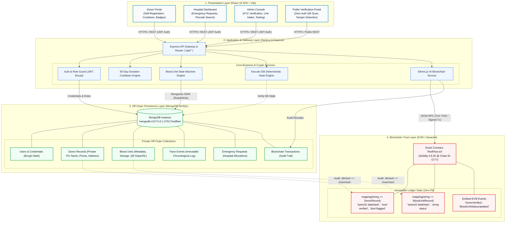
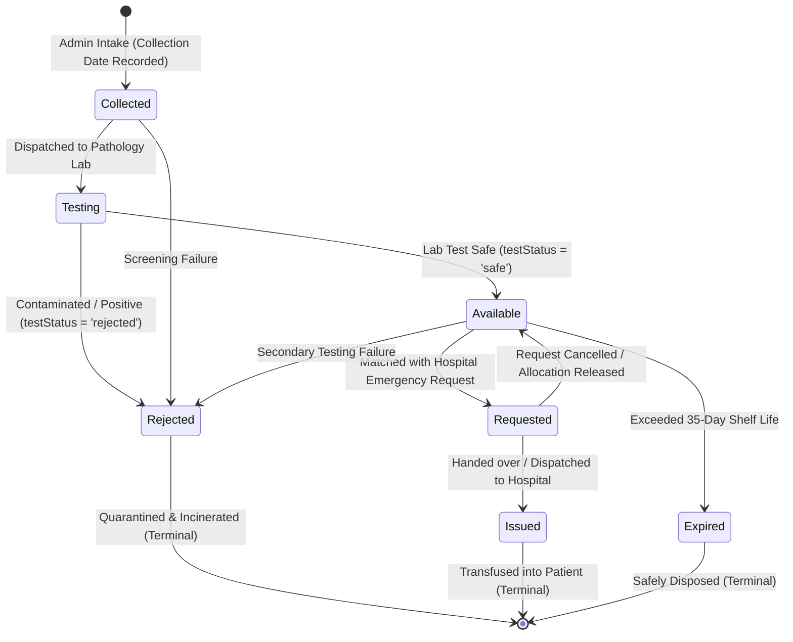
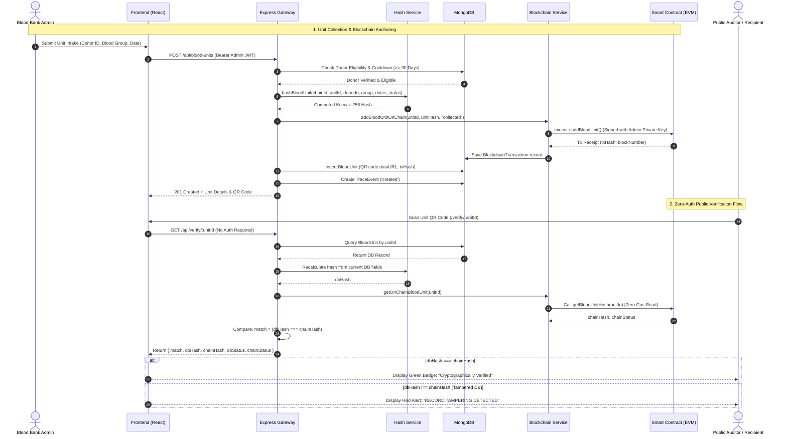

# RedFlow — System Architecture & Technical Design

> **A Secure Blood Supply Ecosystem with Decentralized Donor Verification and Traceability**

RedFlow implements a **4-tier hybrid Web3 architecture** designed for high-throughput clinical operations, strict patient privacy compliance (GDPR/HIPAA-aligned zero-PII on chain), and cryptographic tamper-evidence using Ethereum smart contracts.

---

## 1. System Architecture Overview

---

## 2. Architectural Tiers Breakdown

### Tier 1: Client & Presentation Layer (React 18 SPA)
* **Framework:** React 18, Vite build tooling, React Router DOM v6.
* **State & Authentication:** Custom `AuthContext` with JWT storage in `localStorage`, automatic token injection via Axios request interceptors.
* **Component Libraries & Styling:** RedFlow Design Language (RDL) based on strict 8px spatial grid, high-contrast healthcare palette (Navy `#172B4D`, Medical Teal `#007C91`, Emergency Crimson `#D32F2F`).
* **Actor Portals:**
  * **Donor Portal:** Self-registration, digital profile, 90-day cooldown status indicator, gamified donation tier badges (Bronze, Silver, Gold, Platinum).
  * **Hospital Portal:** Pincode-based blood unit availability lookup, emergency blood request dispatcher, allocation tracking.
  * **Admin Console:** Donor KYC document review, blood unit intake, laboratory testing status updates (`pending` → `safe` / `rejected`), request fulfillment.
  * **Public QR Verification:** Unauthenticated camera/upload QR verification route (`/verify/:unitId`), displaying cryptographic validation status.

### Tier 2: Application & Gateway Layer (Node.js & Express)
* **API Engine:** Express.js REST API with modular controllers and error-handling envelopes.
* **Security & RBAC:**
  * JWT Bearer authentication (`verifyToken`) with 24-hour expiration.
  * Role-Based Access Control (`roleGuard`) for `donor`, `hospital`, and `admin` roles.
  * Passwords hashed via Bcrypt (salt rounds: 10).
* **Cryptographic Hash Engine ([hashService.js](file:///c:/Users/prajw/Desktop/RedFlow/backend/src/services/hashService.js)):**
  * Generates deterministic Keccak-256 fingerprints across fixed schema fields.
  * Guaranteed identical calculation on write (minting/status update) and read (verification).
* **Web3 Blockchain Service ([blockchainService.js](file:///c:/Users/prajw/Desktop/RedFlow/backend/src/services/blockchainService.js)):**
  * Singleton `ethers.JsonRpcProvider` connecting to Ganache (HTTP `127.0.0.1:7545`, Chain ID `5777`).
  * Server-side `ethers.Wallet` signing transactions using the admin private key (users and browsers never handle gas fees or private keys).

### Tier 3: Off-Chain Persistence Layer (MongoDB)
* **Database:** MongoDB running locally on `mongodb://127.0.0.1:27017/redflow`.
* **Privacy Compliance:** Stores all Personally Identifiable Information (PII) including legal names, contact numbers, residential addresses, hospital coordinates, and laboratory diagnosis flags.
* **Traceability Engine:** Logs every state change into `TraceEvent` with timestamp, actor, and associated blockchain transaction receipt.

### Tier 4: Blockchain Trust & Audit Layer (Ethereum EVM)
* **Smart Contract:** `RedFlow.sol` written in Solidity 0.8.20 and compiled via Hardhat.
* **Core Ledger Records:**
  * `DonorRecord`: `{ bytes32 dataHash, bool verified, bool flagged, address verifiedBy, address flaggedBy, uint256 timestamp }`
  * `BloodUnitRecord`: `{ bytes32 dataHash, string status, address createdBy, address updatedBy, uint256 timestamp }`
* **Zero PII Guarantee:** Zero donor names, phones, or medical notes ever enter smart contract storage or EVM event logs.

---

## 3. Blood Unit Lifecycle State Machine

Each blood unit follows a strict, irreversible finite state machine to prevent cross-contamination, unauthorized dispensing, or usage of expired units:

---

## 4. End-to-End Cryptographic Verification Flow

The following sequence diagram details how a blood unit is collected, anchored to the Ethereum ledger, and publicly audited for tampering:

---

## 5. Data Model & Privacy Boundary (Off-Chain vs On-Chain)

| Field / Attribute | Storage Location | Privacy Level | Cryptographic Handling |
| :--- | :--- | :--- | :--- |
| **Donor Legal Name** | MongoDB (`donors.name`) | Private PII | Kept strictly off-chain; never hashed |
| **Donor Phone & Email** | MongoDB (`donors.phone`) | Private PII | Kept strictly off-chain |
| **Residential Address & Pincode** | MongoDB (`donors.address`) | Private PII | Kept strictly off-chain |
| **Medical Flag Reason** | MongoDB (`donors.flagReason`) | Sensitive Medical | Only reason's `keccak256` hash is sent on flag event |
| **Donor Composite Identity** | Smart Contract (`donors[id].dataHash`)| Public Proof | `keccak256(chainId\|donorId\|bloodGroup\|lastDonationDate)` |
| **Donor Verification Status** | Smart Contract (`donors[id].verified`)| Public Proof | Boolean flag set by authorized admin wallet |
| **Blood Unit Composite State** | Smart Contract (`bloodUnits[id].dataHash`)| Public Proof | `keccak256(chainId\|unitId\|donorId\|group\|dates\|statuses)`|
| **Unit Status Tag** | Smart Contract (`bloodUnits[id].status`)| Public Proof | State tag (`collected`, `testing`, `available`, `issued`)|
| **Detailed Lab Diagnosis** | MongoDB (`bloodUnits.testNotes`)| Clinical Data | Kept strictly off-chain |
| **QR Code Image Payload** | MongoDB / Client | Operational Data| Contains URL `http://host:port/verify/<unitId>` |

---

## 6. Deterministic Hashing Specification

To ensure cryptographic integrity, the hash calculation order is fixed and immutable across all tiers:

### Donor Hash Formula
$$\text{donorHash} = \text{keccak256}\left(\text{chainId} \parallel \text{donorId} \parallel \text{bloodGroup} \parallel \text{lastDonationDate}\right)$$

### Blood Unit Hash Formula
$$\text{unitHash} = \text{keccak256}\left(\text{chainId} \parallel \text{unitId} \parallel \text{donorId} \parallel \text{bloodGroup} \parallel \text{collectionDate} \parallel \text{expiryDate} \parallel \text{testStatus} \parallel \text{availabilityStatus}\right)$$

> **Tamper Evident Property:** If an attacker alters any field in the database (e.g., changes an expired unit's `expiryDate` or changes an ineligible donor's `lastDonationDate`), recalculating the hash produces a radically different 32-byte digest, immediately triggering the **Tamper Warning** on verification.

---

## 7. Pre-Rendered Vector Visuals

A vector diagram formatted for presentations and technical project reviews is located in the repository at:
* **Vector File:** [`docs/redflow_system_architecture.svg`](file:///c:/Users/prajw/Desktop/RedFlow/docs/redflow_system_architecture.svg)
